<picture>
  <source media="(prefers-color-scheme: dark)" srcset="assets/banner-dark.svg">
  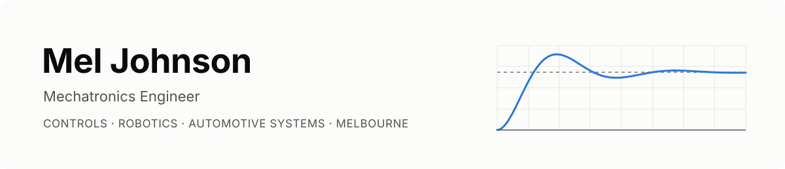
</picture>

I build and test systems where software meets hardware: feedback control, sensor fusion, embedded firmware and vehicle electronics. I like to get close to the real thing, measure it, model it, and make it run reliably.

<picture>
  <source media="(prefers-color-scheme: dark)" srcset="assets/stats-dark.svg">
  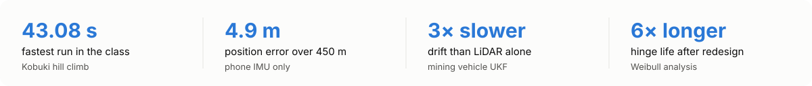
</picture>

**Master of Mechatronics Engineering (Manufacturing)**, University of Melbourne 
**Bachelor of Technology, Electronics and Communication Engineering (IoT and Sensors)**, VIT Vellore

---

### Robotics, sensing and control

<table>
<tr>
<td width="50%" valign="top">
<a href="https://github.com/meljohnsony2k/autonomous-mining-vehicle-sensor-fusion">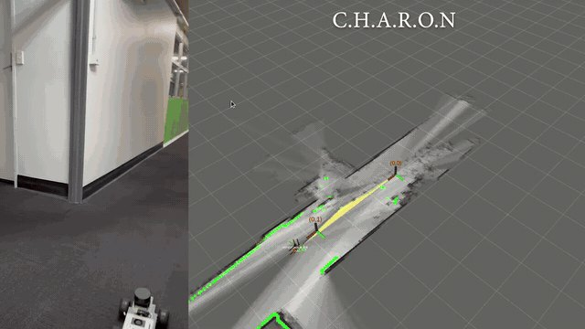</a>
 <b><a href="https://github.com/meljohnsony2k/autonomous-mining-vehicle-sensor-fusion">Autonomous Mining Vehicle Localisation</a></b>
 UKF fusion of IMU, LiDAR (AMCL) and GPS in ROS that keeps the vehicle localised when GPS drops out in tunnels. Error grows about 3× slower than LiDAR alone. Tested on a custom robot.
 ROS · UKF · Gazebo · LiDAR · Python
</td>
<td width="50%" valign="top">
<a href="https://github.com/meljohnsony2k/asc-plant-monitoring-robot">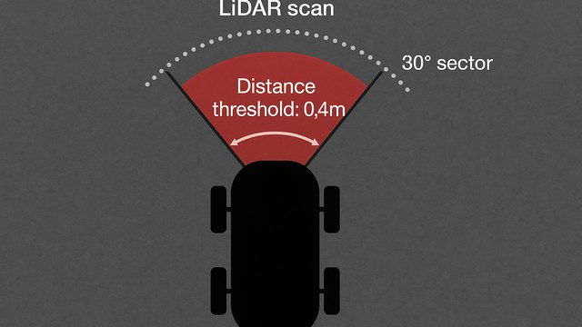</a>
 <b><a href="https://github.com/meljohnsony2k/asc-plant-monitoring-robot">Autonomous Plant Monitoring Robot</a></b>
 Wheel odometry with a measured error model, odometry and vision fusion, mission logic and LiDAR obstacle stopping. Detection turnaround cut from 30 to 60 s down to under 5 s.
 ROS · Sensor fusion · Odometry · LiDAR · YOLO
</td>
</tr>
<tr>
<td width="50%" valign="top">
<a href="https://github.com/meljohnsony2k/kobuki-hill-climb">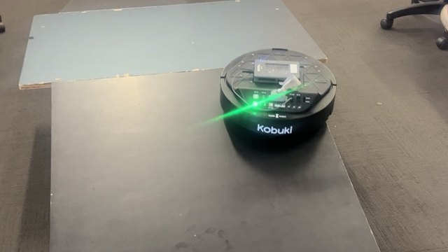</a>
 <b><a href="https://github.com/meljohnsony2k/kobuki-hill-climb">Kobuki Hill Climb</a></b>
 Statechart controller for an obstacle course and ramp. Fastest run in the class (43.08 s). Succeeds on 98.5% of 200 random courses and robots in a custom simulator.
 Statecharts · LabVIEW · myRIO · Python · Monte Carlo
</td>
<td width="50%" valign="top">
<a href="https://github.com/meljohnsony2k/ev3-inverted-pendulum-control">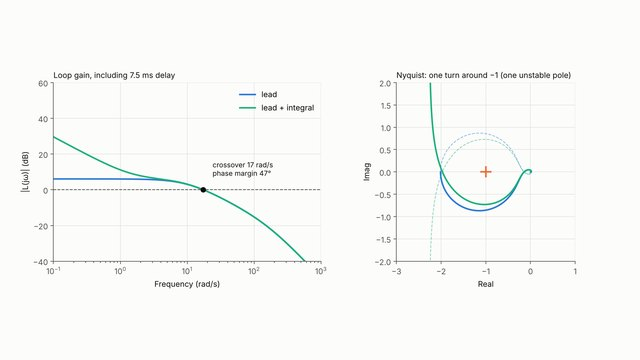</a>
 <b><a href="https://github.com/meljohnsony2k/ev3-inverted-pendulum-control">EV3 Inverted Pendulum</a></b>
 Model fitted from a step test, then a lead controller that balances an unstable pendulum with 47° phase margin, plus integral action for steering loads. Simulated as it runs on the robot, at 5 ms.
 Loop shaping · Nyquist · System ID · Simulink · Python
</td>
</tr>
<tr>
<td width="50%" valign="top">
<a href="https://github.com/meljohnsony2k/pendulum-anti-sway">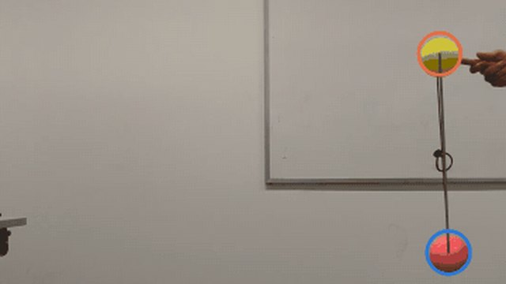</a>
 <b><a href="https://github.com/meljohnsony2k/pendulum-anti-sway">Pendulum Anti-Sway</a></b>
 Computer vision tracking of a hanging load, then a person, a feedback controller and input shaping compared. Input shaping settles in 1.4 s against 3.8 s by hand.
 OpenCV · System ID · Input shaping · Python
</td>
<td width="50%" valign="top">
<a href="https://github.com/meljohnsony2k/gyroscope-dynamics">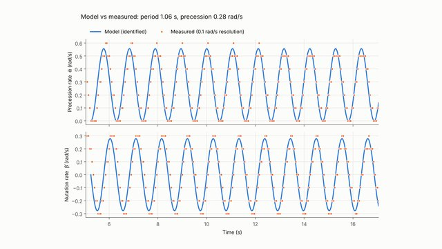</a>
 <b><a href="https://github.com/meljohnsony2k/gyroscope-dynamics">Gyroscope Dynamics</a></b>
 3 DOF model derived with Newton-Euler and Lagrange, fitted to sensor data. Matches the measured nutation period and precession rate.
 MATLAB · SymPy · Rigid body dynamics
</td>
</tr>
<tr>
<td width="50%" valign="top">
<a href="https://github.com/meljohnsony2k/smartphone-pedestrian-navigation">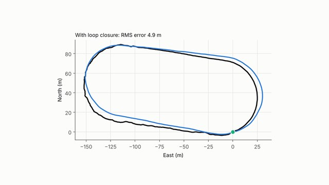</a>
 <b><a href="https://github.com/meljohnsony2k/smartphone-pedestrian-navigation">Smartphone Pedestrian Navigation</a></b>
 Step counting, gyro and compass fused in a Kalman filter, and loop closure, from a phone's IMU alone. 4.9 m RMS position error over a 450 m lap against GPS.
 IMU · Kalman filter · Sensor calibration · Python
</td>
<td width="50%" valign="top">
<a href="https://github.com/meljohnsony2k/mechanical-pet-turtle">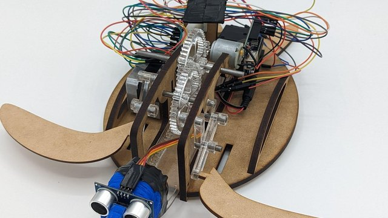</a>
 <b><a href="https://github.com/meljohnsony2k/mechanical-pet-turtle">Mechanical Pet Turtle</a></b>
 Swimming robot with a 23:1 gear train, Chebyshev linkages and a retracting head driven by a stepper and ultrasonic sensor. Firmware tested against a mocked Arduino.
 Mechanisms · Arduino · Laser cutting · C++
</td>
</tr>
</table>

### Automotive and manufacturing

<table>
<tr>
<td width="50%" valign="top">
<a href="https://github.com/meljohnsony2k/autostarke-lexus-engineering-projects">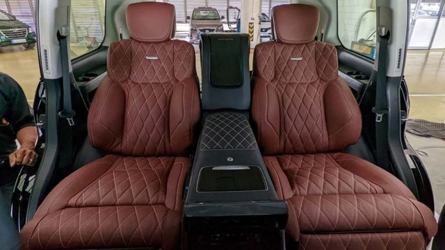</a>
 <b><a href="https://github.com/meljohnsony2k/autostarke-lexus-engineering-projects">Lexus Special Projects (R&D internship)</a></b>
 VIP lounge seat conversion and off road kit for a Lexus LX570, plus PID controlled extending walls for a truck mounted showroom. Real vehicles, delivered to clients.
 Wiring harness · ECU diagnostics · Arduino · PID · Fusion 360
</td>
<td width="50%" valign="top">
<a href="https://github.com/meljohnsony2k/vortex-diagnostics-toolkit">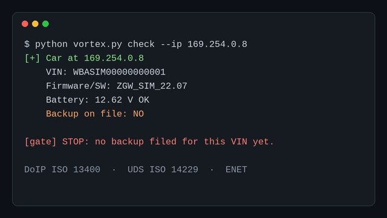</a>
 <b><a href="https://github.com/meljohnsony2k/vortex-diagnostics-toolkit">Vortex Diagnostics Toolkit (BMW / MINI)</a></b>
 Command line tool that reads VIN, module versions, fault codes and battery voltage over ENET, and runs a safety check before coding. Tested against a simulated DoIP gateway.
 DoIP · UDS · Python · Automotive diagnostics
</td>
</tr>
<tr>
<td width="50%" valign="top">
<a href="https://github.com/meljohnsony2k/prusa-mk4s-design-for-manufacture">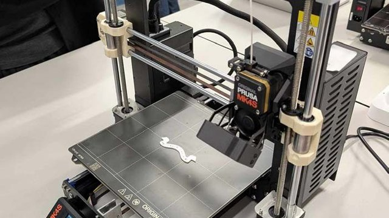</a>
 <b><a href="https://github.com/meljohnsony2k/prusa-mk4s-design-for-manufacture">Prusa MK4S Design for Manufacture</a></b>
 Printer parts redesigned for CNC, injection moulding and sheet metal, then inspected against tolerances. Y axis assembly took 18 min against 37 min predicted.
 SolidWorks · DFM/DFA · Tolerance analysis
</td>
<td width="50%" valign="top">
<a href="https://github.com/meljohnsony2k/hinge-quality-reliability">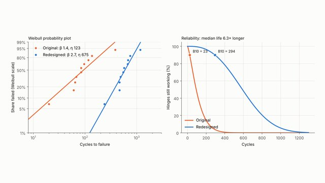</a>
 <b><a href="https://github.com/meljohnsony2k/hinge-quality-reliability">3D Printed Hinge Quality and Reliability</a></b>
 Gage R&R, process capability and Weibull life analysis. Better print settings brought every dimension into spec and made hinges last 6× longer.
 Gage R&R · Cp/Cpk · Weibull · Python
</td>
</tr>
</table>

### Tools

<table>
<tr>
<td width="50%" valign="top">

 <b><a href="https://github.com/meljohnsony2k/rideshare-gst-ledger">Rideshare GST Ledger</a></b>
 Offline web tool that turns bank CSV exports into weekly GST working papers, with auto categorisation and a review queue.
 HTML · JavaScript · Data processing
</td>
</tr>
</table>

---

### Toolkit

| Area | Tools |
|---|---|
| **Controls and robotics** | ROS, Gazebo, sensor fusion (UKF, EKF, Kalman), IMU calibration, SLAM, PID and loop shaping, system identification, statecharts, PLC (Ladder, Structured Text) |
| **Automotive** | Vehicle electronics, CAN, DoIP and UDS diagnostics, ECU diagnostics (Toyota Techstream, OBD-II), BMW coding (E-Sys), wiring harness integration |
| **Embedded and software** | C/C++, Arduino, myRIO, Python, MATLAB/Simulink, LabVIEW |
| **Design and manufacturing** | SolidWorks, Fusion 360, AutoCAD, DFM/DFA, tolerance analysis, Gage R&R, reliability analysis |

[LinkedIn](https://linkedin.com/in/meljohnsony2k) · meljohnsony2k@gmail.com · Melbourne, Australia
